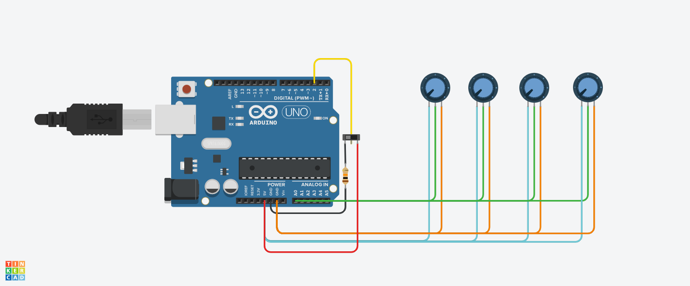

# Estação Meteorológica IoT: simulação no Tinkercad
 
Simulação de uma estação meteorológica com **Arduino Uno** no Tinkercad Circuits. O circuito mede (de forma simulada) **umidade, temperatura, pressão absoluta, pressão relativa, qualidade do ar e detecção de chuva**, e mostra os resultados no Serial Monitor.
 

 
🔗 **Projeto no Tinkercad:** [abrir circuito](https://www.tinkercad.com/things/jZhN8YDUXLe-estacao-meteorologica?sharecode=GVTHxxQTMJNc6qpQ9Q4TK27E4pAPAYjdfnr3PkaXX-Q)
 
---
 
## 1. Contexto da atividade
 
A atividade é baseada na seção *"7. NodeMCU ESP8266 e IoT: desenvolvendo uma estação meteorológica"* do material **Kit Iniciante IoT (Casa da Robótica)**. No projeto original, uma placa **NodeMCU ESP8266** lê sensores reais e envia os dados pela internet ao **ThingSpeak**, onde aparecem em gráficos.
 
| Grandeza | Sensor do projeto original |
|---|---|
| Umidade e temperatura | DHT11 |
| Pressão absoluta e relativa | BMP180 |
| Qualidade do ar | MQ-135 |
| Chuva | Sensor de chuva |
 
## 2. Limitações do Tinkercad
 
- O Tinkercad não possui a **NodeMCU ESP8266**, então foi usado o **Arduino Uno**.
- Não há simulação de **Wi-Fi**, portanto os dados **não são enviados ao ThingSpeak**.
- Os sensores do projeto original não estão disponíveis, então foram **substituídos por componentes simples**.
- A simulação cobre apenas a **leitura e o cálculo das medidas**, sem a parte de IoT (internet e gráficos).
## 3. Componentes e o que representam
 
| Componente | Pino | Representa |
|---|---|---|
| Arduino Uno | — | Substitui a NodeMCU: lê os sinais e executa o código |
| Potenciômetro 1 | A0 | Umidade (0 a 100 %): simula o DHT11 |
| Potenciômetro 2 | A1 | Temperatura (0 a 50 ºC): simula o DHT11 |
| Potenciômetro 3 | A2 | Pressão absoluta (300 a 1100 hPa): simula o BMP180 |
| Potenciômetro 4 | A3 | Qualidade do ar (0 a 1000 ppm): simula o MQ-135 |
| Interruptor deslizante | 2 | Detector de chuva: simula o sensor de chuva |
| Resistor | 2 → GND | Resistor de *pull-down* do interruptor |
 
## 4. Ligações
 
| Fio | Ligação |
|---|---|
| **Azul** | 5V → pino da esquerda de cada potenciômetro |
| **Laranja** | GND → pino da direita de cada potenciômetro |
| **Verde** | Pino do meio de cada potenciômetro → A0, A1, A2 e A3 |
| **Vermelho** | 5V → interruptor |
| **Amarelo** | Interruptor → pino digital 2 |
| **Preto** | Resistor → GND |
 
O pino 2 está ligado ao interruptor e, ao mesmo tempo, ao resistor de *pull-down* que o liga ao GND.
 
## 5. Como a simulação funciona
 
### Potenciômetros (umidade, temperatura, pressão e qualidade do ar)
1. O potenciômetro tem uma ponta no 5V e outra no GND. O pino do meio entrega uma tensão de **0 a 5 V**, conforme a posição do botão.
2. O Arduino lê essa tensão com `analogRead()` e a converte em um número de **0 a 1023**.
3. O código converte o número na grandeza correspondente. Por exemplo, na temperatura, `0 → 0 ºC` e `1023 → 50 ºC`.
4. O resultado é exibido no Serial Monitor.
Na prática, **o usuário faz o papel do sensor**: ao mexer no potenciômetro, "inventa" o valor medido.
 
### Interruptor (detector de chuva)
- O interruptor liga o **5V** ao **pino 2**.
- O **resistor de pull-down** liga o pino 2 ao **GND**, garantindo leitura **0** quando o interruptor está desligado, em vez de um valor aleatório.
- **Interruptor ligado** → pino 2 em 5 V → `digitalRead` retorna 1.
- **Interruptor desligado** → pino 2 em 0 V → `digitalRead` retorna 0.
- O código inverte a leitura (`!digitalRead`) para manter a lógica do sensor de chuva real, que envia **0 quando detecta chuva**:
  - Interruptor ligado → 0 → **"Está chovendo"**
  - Interruptor desligado → 1 → **"Não está chovendo"**
### Pressão relativa
Não tem potenciômetro próprio. Ela é **calculada** a partir da pressão absoluta e da altitude do local (`ALTITUDE`, em metros), com a fórmula de redução ao nível do mar. É a mesma ideia da função `sealevel()` do BMP180 no projeto original:
 
```
pressão relativa = pressão absoluta / (1 - altitude / 44330) ^ 5,255
```
 
## 6. Código
 
O código completo está em [`estacao_meteorologica_tinkercad.ino`](estacao_meteorologica_tinkercad.ino).
 
Resumo da estrutura:
- **Início:** define os pinos e a altitude.
- **`setup()`:** abre a comunicação serial (9600 baud) e configura o pino 2 como entrada.
- **`loop()`:** a cada 2 segundos lê os potenciômetros e o interruptor, calcula as medidas e imprime no Serial Monitor.
 
## 7. Como executar
 
1. Abra o projeto no Tinkercad pelo link acima.
2. Clique em **Start Simulation**.
3. Abra o **Serial Monitor**, no botão na parte de baixo do editor.
4. Durante a simulação, mexa em cada potenciômetro e no interruptor para ver os valores mudarem.
 
## 8. Glossário
 
- **5V:** polo positivo da alimentação do Arduino, de onde a eletricidade sai.
- **GND:** terra (0 V), polo negativo, por onde a eletricidade volta, fechando o circuito.
- **hPa:** hectopascal, unidade de pressão atmosférica. Ao nível do mar a média é de cerca de 1013 hPa.
- **ppm:** partes por milhão, unidade usada para medir a concentração de gases no ar.
- **Pull-down:** resistor ligado ao GND que mantém o pino de entrada em 0 V quando nada o está acionando.
- **Pino analógico (A0 a A5):** lê tensões variáveis de 0 a 5 V, convertidas em 0 a 1023.
- **Pino digital:** lê ou envia apenas dois estados: 0 (LOW) ou 1 (HIGH).